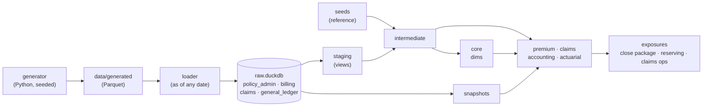

# dbt-insurance-analytics


An analytics engineering project for a fictional US personal lines insurer (private passenger
auto and homeowners, 2022 to 2026). Four source systems arrive the way real loaders deliver them,
with the defects real data has. dbt turns them into premium, claims, accounting and actuarial
marts. Every key figure is reconciled to a general ledger and to control totals computed
independently in Python. The insurer, its policyholders and every figure are generated: names,
birth dates and ZIP codes are random draws, and any match with a real person or company is
coincidence.

Everything runs locally on DuckDB in a few minutes, with no account and no cost, and CI rebuilds
it from scratch on every push.

## Results

Rebuilt from an empty warehouse at the default settings (seed 42, valuation date 2026-09-30).
Each figure was checked by something other than the code that produced it.

| Check | Result |
|---|---|
| Build | `dbt build` into empty dev and prod databases: 787 nodes each, 0 errors, about a minute each |
| Warnings | 2, both planted defects that are kept and flagged on purpose, at their exact planted counts: 13 losses outside the policy term, 5 orphan claims |
| Control totals | all 1,056 figures the generator computed in Python (11 metrics, by period or accident year and line) equal the SQL results |
| General ledger | 1,570 account × source system × period × line rows (2022-01 to 2026-08): 1,564 match, 6 are the two documented reconciling items, 0 unexplained, with no tolerance |
| Premium | all-time written premium equals the raw transactions to the cent (auto $42,404,506.34, home $29,051,754.93), and earned plus unearned equals written exactly |
| History | 21 month-end closes replayed in under 4 minutes; 20 of them (2025-01 to 2026-08) had closed by the valuation date, and restated policies in force differ from the as-reported figure in 26 of their 40 period × line rows, by −1 to +3 policies |
| Reproducibility | two generator runs write byte-identical files |

Volume: 24,316 policies, 68,558 terms, 82,236 premium transactions (290,285 coverage lines),
352,980 installments, 299,262 payments, 4,477 claims in 8,597 CDC versions, 44,206 claim
transactions and 1,822 ledger lines.

Accident-year loss ratios (incurred loss over earned premium, at the valuation date):

| Accident year | Auto | Home | Home excluding catastrophes |
|---|---|---|---|
| 2022 | 71% | 66% | 57% |
| 2023 | 87% | 86% | 65% |
| 2024 | 69% | 59% | 52% |
| 2025 | 58% | 78% | 59% |
| 2026 (9 months) | 63% | 65% | 53% |

Auto 2023 is high mostly because of bodily injury: that accident year has the highest bodily
injury frequency (1.3 claims per 100 exposure years, against 1.0 in 2024) and average severity
($27,700 per claim). The generator plants no 2023 shock, so this is random variation in a few
large claims. 2025 and 2026 are immature: claims for those accidents are still being reported
and their reserves still develop. The chain-ladder analysis in `analyses/` projects 2025 to
ultimate (auto 63%, home 79%) and leaves 2026 unprojected, because that accident year is not
over (docs/guide-claims.md section 8).

## What is in it

| Area | What the models do |
|---|---|
| Sources | Policy administration and billing (Fivetran-style: current state, soft deletes), claims (Rivery-style append-mode CDC: one row per change), general ledger (monthly CSV exports, all text). See [docs/source-systems.md](docs/source-systems.md). |
| Data quality | 20 planted defects: test policies in production, CDC duplicates, deleted claims, legacy status codes, malformed policy numbers, orphans, late-entered and backdated transactions, voided and returned payments, a re-exported ledger file, a number format change. Each one is handled and tested. See [docs/data-issues.md](docs/data-issues.md). |
| Premium | Written premium by booked accounting period, earned and unearned premium, policies in force, in-force premium, earned exposure. |
| Claims | Case reserves with payment erosion, net paid, incurred, void reversals in the void period, reopened claims, claim and exposure balances per month, loss development triangles. |
| Accounting | Subledger-to-GL postings, a reconciliation with documented reconciling items, a trial balance, unearned premium and loss reserve rollforwards, premium receivable and aging. |
| Actuarial | Calendar-period and accident-year loss ratios with and without catastrophes, frequency and severity, chain-ladder development factors. |
| History | Snapshots of overwritten source rows, and a month-end close simulation that compares "as reported at close" with "restated today". |

dbt features used: sources with freshness, seeds, staging / intermediate / marts layers, views,
tables and an incremental model, YAML-configured snapshots, generic and singular tests with
warn thresholds, unit tests, model contracts, exposures, analyses, macros, a custom
`generate_schema_name`, and separate raw / dev / prod databases.

## Architecture



Three databases stand in for three warehouse projects: `raw` is written only by the loader,
`dev` and `prod` only by dbt, and both attach `raw` read-only. Schemas name layers and domains
(`staging`, `core`, `premium`, ...), because the database already names the environment. See
[docs/architecture.md](docs/architecture.md) and [docs/decisions.md](docs/decisions.md).

## Why DuckDB and not BigQuery

The models target a cloud warehouse workflow, but run on DuckDB, because BigQuery without
billing (the sandbox) cannot run this project. Google's
[sandbox page](https://docs.cloud.google.com/bigquery/docs/sandbox) lists these limits:

- no DML statements, such as MERGE, UPDATE and DELETE;
- no streaming and no Data Transfer Service;
- every table, view and partition expires after 60 days;
- a lifetime 10 GiB storage limit that is not refunded when data is deleted.

| Feature used here | BigQuery sandbox | DuckDB |
|---|---|---|
| Snapshots (`snapshots/`) | no: dbt snapshots run a MERGE | yes |
| Incremental model (`fct_claim_transactions`) | no: dbt-bigquery's merge, insert_overwrite and microbatch strategies all use MERGE | yes |
| History older than 60 days (snapshots, month-end close simulation) | no: tables expire | yes |
| Rebuilding everything on every run | eats into a lifetime storage limit | unlimited |
| Loader-style upserts, soft deletes, CDC in raw | no: needs DML or streaming | yes |
| CI on every push | needs cloud credentials in the repo's secrets | no credentials at all |
| Anyone can clone and run it | needs their own Google Cloud project | `uv sync` and go |

Enabling billing removes the limits, and this volume would likely stay within the free usage
tier, but it requires a payment method, and everyone who clones the repo would need their own
billed project. Moving to BigQuery later is mostly a new profile plus a few date functions; see
[docs/decisions.md](docs/decisions.md) (D-001).

## Quickstart

Requires [uv](https://docs.astral.sh/uv/). From the repo root:

```powershell
uv sync                         # Python 3.14, dbt, DuckDB and its CLI, into .venv
.venv\Scripts\Activate.ps1      # Git Bash / macOS / Linux: source .venv/Scripts/activate or .venv/bin/activate
python -m generator             # simulate 2022-01 .. 2026-09 into data/generated/
python -m loader                # build warehouse/raw.duckdb as the connectors would have left it
dbt deps
dbt build                       # seeds, models, snapshots and every test, into warehouse/dev.duckdb
dbt build --target prod         # the same into warehouse/prod.duckdb
```

Look at the results with the DuckDB CLI (installed into the venv). Attach raw first, since the
staging views read from it:

```powershell
duckdb warehouse/dev.duckdb "ATTACH 'warehouse/raw.duckdb' AS raw (READ_ONLY); select * from accounting.rpt_unearned_premium_rollforward order by accounting_period desc limit 12"
```

Optional: `python scripts/simulate_month_end_closes.py --start 2025-01 --end 2026-09 --fresh`
replays month-end closes and snapshots after each one, so the snapshots hold real history. The
history exists only in the database the script writes, `warehouse/dev.duckdb` by default: a
plain `dbt build` runs the snapshots once and records no past. To give prod the history, add
`--dev-path warehouse/prod.duckdb`, then run `dbt build --target prod`.

## How the results are checked

A number counts only if something other than the code that produced it agrees with it.

1. **Control totals.** The generator computes written, earned and unearned premium, policies in
   force, paid losses, case reserves and claim counts in Python from its own records. The dbt
   models compute the same figures in SQL from the raw tables, and tests in `tests/` compare them
   per period and line of business. A guard test fails if the load is not the one the totals
   describe, so the comparisons cannot pass by being skipped.
2. **General ledger.** The ledger's journals are posted from the subledgers at each close. The
   reconciliation model rebuilds those postings from the marts and compares every account, period
   and line. Differences must be documented as reconciling items in
   `seeds/gl_reconciling_items.csv`, or a test fails.
3. **Planted defects.** The generator records how many rows it corrupted; tests check that
   staging removed or flagged exactly that many.
4. **Unit tests** pin the logic most likely to break quietly: the booking rule, the earning
   formula, CDC deduplication, void reversals, ledger amount parsing.

## Repo tour

| Path | What |
|---|---|
| `generator/` | The simulation: policies, renewals, endorsements, cancellations, billing, claims, ledger, defects, control totals |
| `loader/` | Builds `raw.duckdb` as of any moment; `raw_schema.sql` is the raw contract |
| `models/staging/` | One model per source table: rename, cast, normalize, deduplicate, flag |
| `models/intermediate/` | Booking, earning, claim financial events, subledger postings |
| `models/marts/` | `core` dims, `premium`, `claims`, `accounting`, `actuarial` |
| `snapshots/` | History of rows the policy and billing systems overwrite |
| `tests/` | Reconciliations, rollforwards, control totals, planted-defect counts |
| `analyses/` | Chain-ladder development factors |
| `seeds/` | Accounting calendar, coverages, states, loss causes, catastrophe events, GL accounts, reconciling items |
| `docs/` | Specification, decisions, open items, glossary, and a guide per domain |

## Learning path

Start with [docs/insurance-glossary.md](docs/insurance-glossary.md), then follow one domain end
to end:

1. [docs/guide-premium.md](docs/guide-premium.md): from policy transactions to earned premium
   and policies in force.
2. [docs/guide-claims.md](docs/guide-claims.md): from CDC versions to incurred losses and
   triangles.
3. [docs/guide-accounting.md](docs/guide-accounting.md): subledgers, the ledger, reconciliation
   and rollforwards.
4. [docs/guide-snapshots-and-actuarial.md](docs/guide-snapshots-and-actuarial.md): snapshots,
   as-reported versus restated, loss ratios.

## How this was built

This project was built with Claude Code, an AI coding agent, working from the specification in
`docs/` (business rules, raw contract, defect catalog). I direct the work and review what it
produces; commits it drafted carry a `Co-Authored-By` trailer. The reconciliations and control
totals exist partly to make that review trustworthy: generated code has to agree with
independently computed numbers before it counts.

## Roadmap

- A cloud warehouse target (the SQL avoids DuckDB-only features where standard SQL works).
- One real public source next to the generated core, such as flood insurance claims.
- A hosted dbt docs site and a small dashboard on the marts.
- Reinsurance (ceded premium and losses), and IBNR as a mart (today it is estimated only in the
  chain-ladder analysis).
